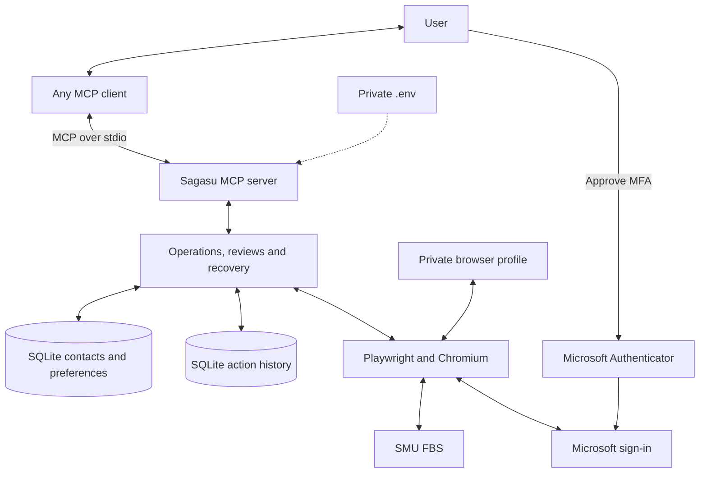

[](https://github.com/gongahkia/sagasu/releases/tag/1.0.0)


# `Sagasu`

<p align="center">

</p>

A [MCP Server](https://modelcontextprotocol.io/docs/2026-07-28/getting-started/intro) to help your [agents](https://cursor.com/help/ai-features/coding-agents) work with [SMU FBS](https://www.smubondue.com/facility-booking-system-fbs).

## Rationale

[SMU's Facility Booking System](https://fbs.intranet.smu.edu.sg/home) isn't an inherently slow website. Booking facilities in itself is quick.

If anything, the sluggish impression it gives off results from the overly convoluted system users must navigate to search for available rooms.

`Sagasu` is a MCP Server that gives your agents access to SMU FBS' search, book, cancel and all other user-specified interactions.

## Stack

- [Python](https://www.python.org/) — server and browser automation runtime.
- [MCP Python SDK](https://github.com/modelcontextprotocol/python-sdk) — standard MCP tools, resources, prompts and stdio transport.
- [Playwright](https://playwright.dev/python/) and [Chromium](https://www.chromium.org/) — SMU FBS browser automation.
- [Pydantic](https://docs.pydantic.dev/) — typed tool inputs and validation.
- [SQLite](https://www.sqlite.org/) — private contacts, search preferences and durable action history.
- [python-dotenv](https://github.com/theskumar/python-dotenv) — private host configuration.
- [uv](https://docs.astral.sh/uv/) — Python environments and dependency installation.

## Usage

> [!NOTE]  
> `Sagasu` relies on Python 3.11+.

The below are for locally running `Sagasu` on your machine.

1. First run the below set-up instructions using [uv](https://docs.astral.sh/uv/getting-started/installation/).

```console
$ git clone https://github.com/gongahkia/sagasu && cd sagasu
$ uv venv
$ source .venv/bin/activate
$ uv pip install -e .
$ python -m playwright install chromium
$ sagasu config init
$ sagasu doctor --timeout 30
$ sagasu login
```

2. Then talk to your agent to ask them to interact with `Sagasu`. Below are some examples.

```txt
Find an SCIS1 group study room tomorrow from 2–4pm.

Book any available room in that window for project work with my saved co-booker Alex.

Show my bookings and cancel the one I no longer need.
```

## Architecture



## Contributors

<table>
	<tbody>
        <tr>
	    <td align="center">
                <a href="https://github.com/gongahkia">
                    
                    <br/>
                    <sub><b>gongahkia</b></sub>
                </a>
            </td>
            <td align="center">
                <a href="https://github.com/SpringOrca69">
                    
                    <br/>
                    <sub><b>SpringOrca69</b></sub>
                </a>
            </td>
			<td align="center">
                <a href="https://github.com/injaneity">
                    
                    <br/>
                    <sub><b>injaneity</b></sub>
                </a>
            </td>
        </tr>
	<tbody>
</table>
